

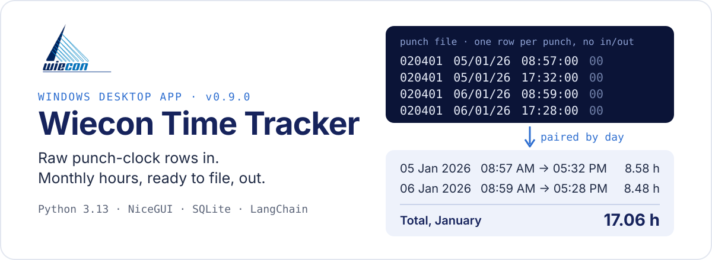

  

A 120-second tour of what the program does, from raw punch file to filed monthly hours. Click the image to play. Every name and punch in this README is invented — no real employee data appears anywhere.

> [!NOTE]
> **This is a showcase repository.** It holds the README, screenshots, diagrams, the user guide and a sample report so you can see what the program does. The source code and prebuilt builds are private.

## About this project

| | |
| :--- | :--- |
| **What it is** | A Windows desktop app that turns a punch clock's raw export into the monthly hours-worked figures Wiecon Consultants Taiwan files with the government |
| **Who uses it** | The office secretary, every month. The monthly report went from 1 h 20 min to 20 min |
| **Timeline** | 14 releases in 8 weeks, from 0.1.2 on 6 August 2026 to 0.9.0 on 1 October 2026 |
| **Scale** | About 3,400 lines of Python in three packages, a three-table SQLite schema, four kinds of PDF report |
| **Stack** | Python 3.13 · NiceGUI · SQLModel over SQLite · pendulum · fpdf2 · LangChain with Gemini · PyInstaller |

Built by [**@ThunderIW**](https://github.com/ThunderIW).

### Engineering highlights

- **Bare timestamps into working days.** The punch clock records a time and nothing else: no in/out flag. The app groups each employee's punches by day and measures from first to last, so a stray midday punch can't split one day into two. [See it on sample data →](#06-example-workflow-getting-monthly-hourly-report)
- **One query layer for everything.** The screen and the AI assistant both read through a single class, `InteractWithDatabase`, so they can never quote different numbers. [Architecture →](#04-architecture)
- **An AI assistant that can't invent figures.** A supervisor agent hands each question to two tool-calling specialists, whose prompts forbid stating any number they haven't fetched through a read-only database tool. [AI assistant →](#ai-assistant)
- **Integrity enforced by the database.** Foreign keys are switched on for every SQLite connection, so punches for unknown badge numbers are rejected and removing an employee cascades to their punches.
- **Shipped like a product.** A single Windows executable built with PyInstaller, a release-notes PDF with every version, a step-by-step user guide and a two-minute promo video.

 

**User guide:** **[PDF](docs/user-guide/Wiecon%20Time%20Tracker%20-%20User%20Guide.pdf)** &nbsp;·&nbsp; **[HTML file](docs/user-guide/Wiecon%20Time%20Tracker%20-%20User%20Guide.html)**

A step-by-step guide for the people using the app: numbered screenshots for every screen, from uploading the punch file to downloading the timesheets. The <b>PDF</b> opens right here. GitHub can't preview the <b>HTML file</b>; to use it offline, click the download button next to <i>Raw</i> and open it in Edge or Chrome.

 

| # | Section | What's in it |
| :---: | --- | --- |
| 01 | [Why this exists](#01-why-this-exists) | The two-program manual routine this replaces, and the figure it produces |
| 02 | [Testimonials](#02-testimonials) | What the people using it every month say |
| 03 | [Features](#03-features) | The six things the program actually gives you |
| 04 | [Architecture](#04-architecture) | Front end, back end, the three tables, and what is derived rather than stored |
| 05 | [Design decisions and lessons](#05-design-decisions-and-lessons) | What went wrong in real use, and how the design changed because of it |
| 06 | [Example workflow (Getting monthly hourly report)](#06-example-workflow-getting-monthly-hourly-report) | A complete run on invented data, from uploaded CSV to the filed total |
| 07 | [Scope and known issues](#07-scope-and-known-issues) | What it doesn't do, and three behaviours worth knowing |
| 08 | [Milestones](#08-milestones) | How the program has grown |
| 09 | [Copyright and license](#09-copyright-and-license) | Proprietary software |

 

---

## 01. Why this exists

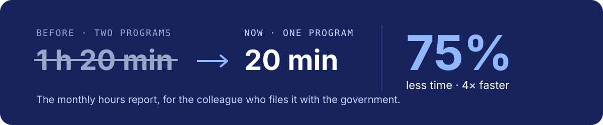

In the current setup, employees check in and check out using a punch system that lets them use either their fingerprint or a code. Before this program, the employee in charge of keeping tabs on this, the secretary, had to perform the following steps every month:

1. Download the plaintext file that holds all the punch entries.
2. Upload it to another piece of software to extract the required information: the total number of hours each employee worked that month, as required by the government.

As a result of introducing this system, the task now takes the secretary 20 minutes instead of 1 hour and 20 minutes. That cuts the time spent by 75%, making the job four times faster.


---

## 02. Testimonials

> *"Monthly hours used to be a chore. Now they’re done before my coffee gets cold."*
>
> — Office secretary, Wiecon

---

## 03. Features
Six things the program does:

**1.**  
Several punch files can be uploaded at once. Bad rows — entries for people who don't work for the company — are reported back to you and left out, while everything else is stored.

**2.**  
The punch system records only a time, with no indication of a check-in or a check-out. The program resolves each day into a date, a start time and an end time, so it is clear when an employee began and finished work.

**3.**  
Rows with a missed punch-out are coloured red, short days under 8 hours are coloured amber, and everything else stays white.

**4.**  
A full monthly timesheet for all employees, a single employee's selected days, a zero-hours sheet to be signed by hand, and a timesheet for an individual employee for a selection of months and year with an added summary page.

**5.**  
A multi-agent AI assistant (LangChain + Google Gemini) that answers natural-language questions about employee attendance. A supervisor agent delegates each question to specialist agents, which autonomously select and invoke database query tools — ask it about an employee's details, the hours they worked on a given day, their total hours for a month, or who worked zero hours.

**6.**  
A UI interface that lets users delete unwanted attendance data or resigned employees from the system, with a confirmation pop-up to prevent accidental or unwanted deletion.

---

## 04. Architecture

    

A NiceGUI front end over a SQLite database accessed through SQLModel ([SQLAlchemy](https://www.sqlalchemy.org/)), on Python 3.13.

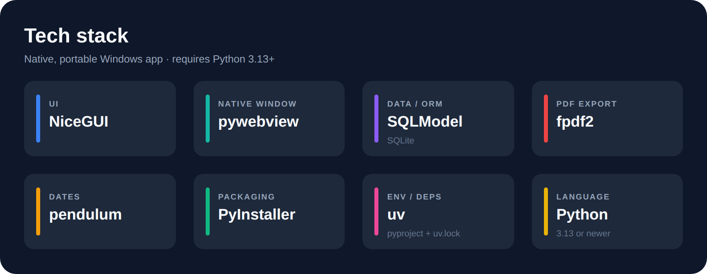

Everything reaches <code>attendance.db</code> through one query layer, <code>InteractWithDatabase</code>, which is why the screen, the PDFs and the assistant can never quote different numbers. The assistant's agents reach it only through read-only tools.

### Front end

NiceGUI 3.15. The app uses no routing: rather than declaring pages with `@ui.page`, `main.py` passes a single function to `ui.run(root=index)`, and `index()` builds the entire interface — every other screen is a dialog opened from the header or the Tools tab.

The parts that change are `@ui.refreshable` functions, re-rendered on demand instead of by reloading the page. They cover whether the assistant's API key is set, the year and month navigation buttons so only months with data are offered, the metric cards showing the selected employee's average and total hours, and the attendance table itself, rendered with [AG Grid](https://www.ag-grid.com/) via `ui.aggrid` for the chosen employee and month. The yearly chart is a [pyecharts](https://pyecharts.org/) bar chart passed through `ui.echart.from_pyecharts`.

Run normally it serves in the browser over [uvicorn](https://www.uvicorn.org/); the packaged build wraps the same page in a [pywebview](https://pywebview.flowrl.com/) desktop window.

### Back end

The backend uses SQLite, with SQLModel providing the schema definition and query interface. Tables are declared as SQLModel classes in `Database/create_database.py` and initialized on import, so no migration step is required. Every query the program runs goes through a single dedicated Python class, `InteractWithDatabase` in `Database/QueryDatabase.py`, and both the UI and the AI assistant share it. This eliminates any chance of the two diverging — they are always reading the same numbers from the same database.

Each row's date and time are read from the uploaded plain text and parsed with [pendulum](https://pendulum.eustace.io/), so `05/01/26 08:57:00` becomes `05 January 2026` and `08:57 AM`, both on screen and in the exported PDFs.


> [!NOTE]
> `PRAGMA foreign_keys=ON` is set on every connection. SQLite leaves foreign keys unenforced by default, and both the cascade from an employee to their punches and the rejection of punches for unknown badge numbers depend on it.

### AI assistant

A multi-agent system built with [LangChain](https://www.langchain.com/)'s `create_agent` and [Google's Gemini](https://ai.google.dev/gemini-api/docs). It answers natural-language questions about employee attendance using a supervisor and two specialist agents, all running on the same model:

One question, in order. Gemini only picks the agent and the tool; the hours come from the database through a read-only tool, and a missing day comes back as "no record", never as a guess. <code>hours_agent</code> answers its questions the same way.

- **The supervisor** talks to you. It never answers from its own knowledge: it turns your question into self-contained requests, sends them to one or both specialists, and combines what they report.
- **The specialists** are tool-calling agents. Each one autonomously selects and invokes its database query tools, reads the results, and reports the facts back. Their prompts forbid stating any figure they haven't retrieved through a tool, and require them to report "no data" rather than zero hours.

| Agent | Tool | What it returns |
| --- | --- | --- |
| Both | `find_employee` | Full employee names containing the text given, so "amy" resolves to "林佳蓉 Amy" |
| `Attendance_agent` | `get_person` | An employee's badge number and their per-day start and end times |
| `Attendance_agent` | `get_hours_worked_on_particular_day` | Start time, end time and hours worked for one employee on one date, given in any common date format |
| `hours_agent` | `get_total_hours_worked_month_and_year` | An employee's total hours for a given month and year, summed live from their punches |
| `hours_agent` | `get_zero_hours_employees` | Every day in a month where an employee's hours come out at zero |
| `hours_agent` | `get_available_years` | The years that have calculated monthly hours on record |

Only the supervisor's reply is streamed into the chat. Each message is answered on its own; the assistant doesn't carry earlier messages forward, and every tool is read-only.

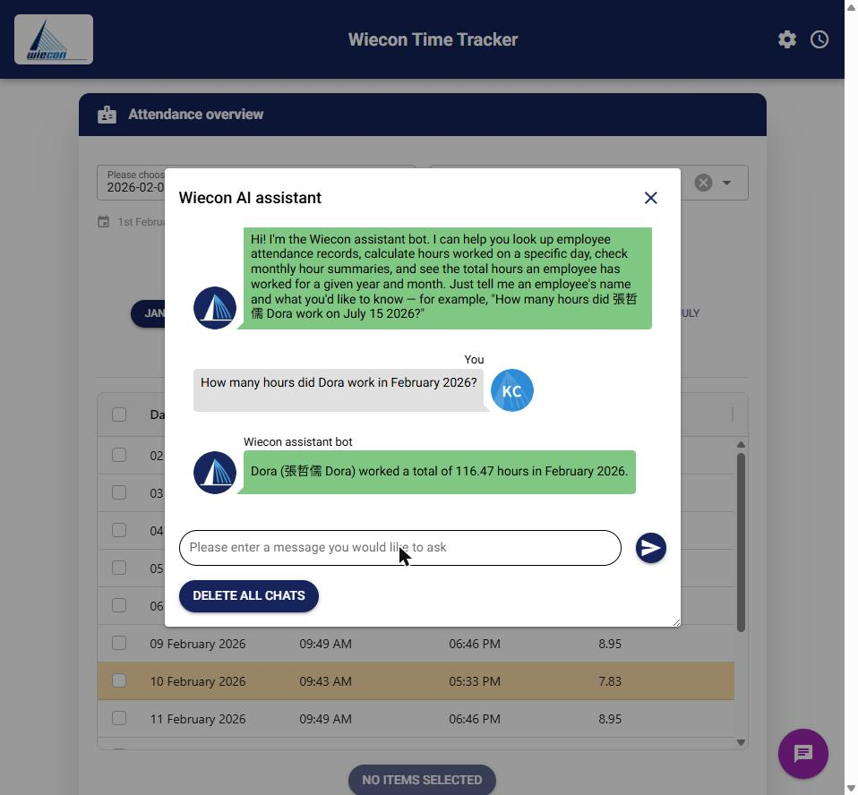

### Project layout

About 3,400 lines of Python across three packages. Two thirds of that is `main.py`, because the entire interface is built in one function.

Four modules, and everything funnels through one of them:


<table>
<tr><th align="left">Module</th><th align="right">Lines</th><th align="left">Share of the Python in this repo</th></tr>
<tr><td><code>main.py</code></td><td align="right">2334</td><td><code>████████████████████</code></td></tr>
<tr><td><code>Database/QueryDatabase.py</code></td><td align="right">573</td><td><code>█████</code></td></tr>
<tr><td><code>Chat_bot/bot_setup.py</code></td><td align="right">420</td><td><code>████</code></td></tr>
<tr><td><code>Database/create_database.py</code></td><td align="right">64</td><td><code>█</code></td></tr>
</table>

The full tree, including what is not code:

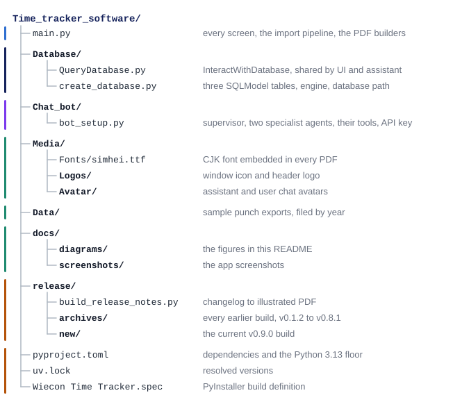

Where to start reading, depending on what you are looking for:

| To understand | Read | Start at |
| --- | --- | --- |
| The whole application | `main.py` | `index()` — it builds every screen in one pass |
| How hours are derived from punches | `Database/QueryDatabase.py` | `group_punches_by_day` |
| The schema | `Database/create_database.py` | the three SQLModel classes |
| What the assistant can and cannot do | `Chat_bot/bot_setup.py` | `SUPERVISOR_PROMPT` and the `agent` class, then the two specialist agents and their `@tool` functions |
| How a release is cut | `release/build_release_notes.py` | `VERSION` and `CHANGELOG` at the top |

---

## 05. Design decisions and lessons

Most of the design came from problems found in real use. These are the changes that shaped it most:

| Problem in real use | Decision | Why |
| --- | --- | --- |
| Importing a whole year of punch files at once crashed the app (0.7.0). | Limit uploads to three files at a time. | A clear limit is better than a crash halfway through an import. |
| Building a large timesheet PDF for every employee froze the app (0.1.6). | Build the PDF off the main thread, with a loading indicator. | The window stays responsive while a big report is made. |
| Hours had to be recalculated by hand after every upload (0.1.3). | Recalculate on every upload; keep the manual recompute only for restores and deletions. | The figures on screen are never stale after an import. |
| The zero-hours sheet put afternoon punches under Start Time, so a forgotten punch-in looked like a forgotten punch-out (0.6.0). | Write an afternoon punch under End Time and leave Start Time blank. | The secretary has to know which punch to ask the employee about. |
| The AI assistant failed silently without a key or internet, and the key had to be typed into `.env` by hand (0.5.0). | Set the key from inside the app, and say plainly when a request fails. | The person using it isn't a developer and has to see what went wrong. |
| Removing an employee or a month of data can't be undone (0.8.0). | One shared confirmation dialog that names exactly what will be removed. | Every destructive action asks the same way, so nothing is deleted by accident. |

---

## 06. Example workflow (Getting monthly hourly report)

 

A complete run on invented data, from an uploaded punch file to the total the firm files.

 The whole run at a glance. Each step is walked through below.

<b>Watch the whole run, animated</b> (a 26-second loop of the four steps below)

 


### Step one: add the employees

Through <kbd>Employees</kbd> → <kbd>Employee Tools</kbd> → <kbd>Manage</kbd> → <kbd>Add Employee</kbd>. Employees must exist before any of their punches will import, so this comes first.

| ID Number   | English Name    | Chinese Name       | 
|-------------|-----------------|--------------------|
| 20401       | Alice Bennett   | 王雅婷               |
| 20402       | Marco Reyes     | 李承翰             |
| 20403       | Ingrid Halvorsen |                    |

The Chinese name is optional. The software was built for an international company in Taiwan, where some employees go by a Chinese name only and others by an English one.

### Step two: drop the punch file

Through <kbd>Timesheet</kbd> → <kbd>Upload Timesheet</kbd>. 
The file itself has no header row; 
the columns below are labeled for readability only.

| ID Number | Date | Time | Status |
| --- | :---: | :---: | :---: |
| 020401 | 05/01/26 | 08:57:00 | 00 |
| 020401 | 05/01/26 | 17:32:00 | 00 |
| 020402 | 05/01/26 | 09:14:00 | 00 |
| 020402 | 05/01/26 | 18:03:00 | 00 |
| 020403 | 05/01/26 | 08:45:00 | 00 |
| 020403 | 05/01/26 | 17:10:00 | 00 |
| 020401 | 06/01/26 | 08:59:00 | 00 |
| 020401 | 06/01/26 | 17:28:00 | 00 |
| 020402 | 06/01/26 | 09:02:00 | 00 |
| 020402 | 06/01/26 | 12:30:00 | 00 |
| 020402 | 06/01/26 | 18:11:00 | 00 |
| 020404 | 06/01/26 | 09:00:00 | 00 |

The real file is **plain text** with one row per punch. Nothing in it says which punch is an arrival and which a departure, or groups an employee's punches by day; working that out is the program's job.


Eleven rows import. Badge 20404 belongs to nobody, so its punch is dropped and reported as a skipped ID. The malformed last row is counted separately. The import then recalculates hours for the three employees it touched and moves the date picker to 6 January 2026, the newest punch it saw.

### Step three: read the month

| Employee | Date | Start | End | Hours |
| --- | --- | --- | --- | --- |
| Alice Bennett | 05 January 2026 | 08:57 AM | 05:32 PM | 8.58 |
| Alice Bennett | 06 January 2026 | 08:59 AM | 05:28 PM | 8.48 |
| Marco Reyes | 05 January 2026 | 09:14 AM | 06:03 PM | 8.82 |
| Marco Reyes | 06 January 2026 | 09:02 AM | 06:11 PM | 9.15 |
| Ingrid Halvorsen | 05 January 2026 | 08:45 AM | 05:10 PM | 8.42 |

Marco punched three times on 6 January. The middle punch at 12:30 is discarded, and the day is measured from first to last, giving 9.15 hours rather than two separate spans. Alice's stored monthly average comes out at 8.53 hours.

The month's average and total sit under the table, with the year's totals charted beneath them:

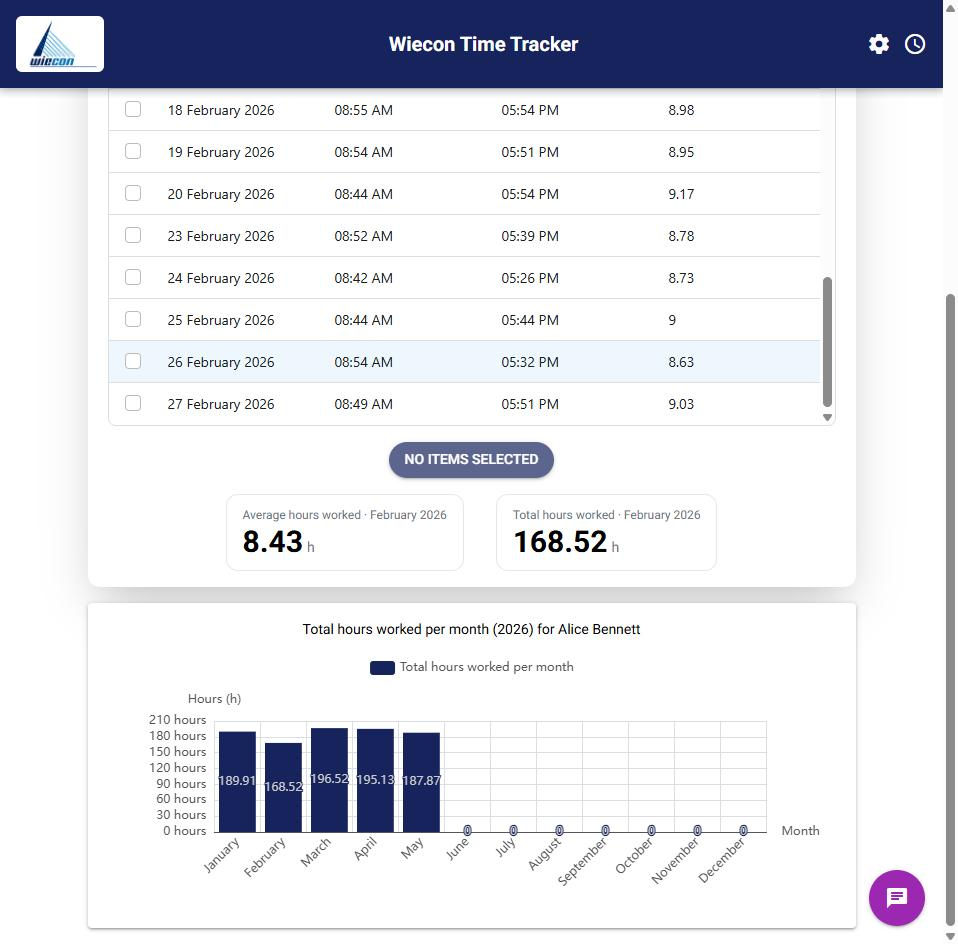
 The total is summed from punches every time it is displayed, not read from the cache.

Selecting rows opens them for review and export. A day with one punch shows plainly as zero hours:

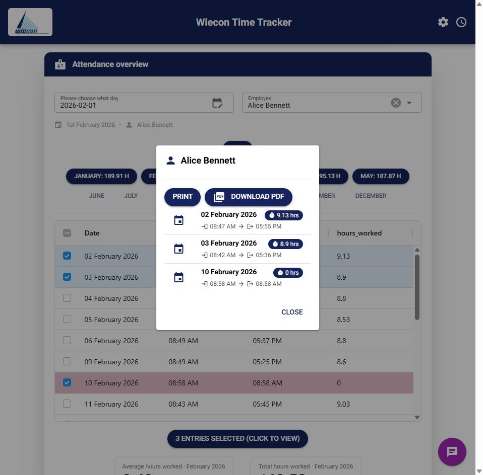

### Step four: export the timesheet

<kbd>Employees</kbd> → <kbd>Employee Tools</kbd> → <kbd>Download</kbd> → <kbd>Timesheet</kbd>, then <kbd>Download timesheet for 2026 January</kbd>, builds the whole month, one A4 landscape page per employee, merged into a single file named `Employee timesheet 2026_January.pdf`:

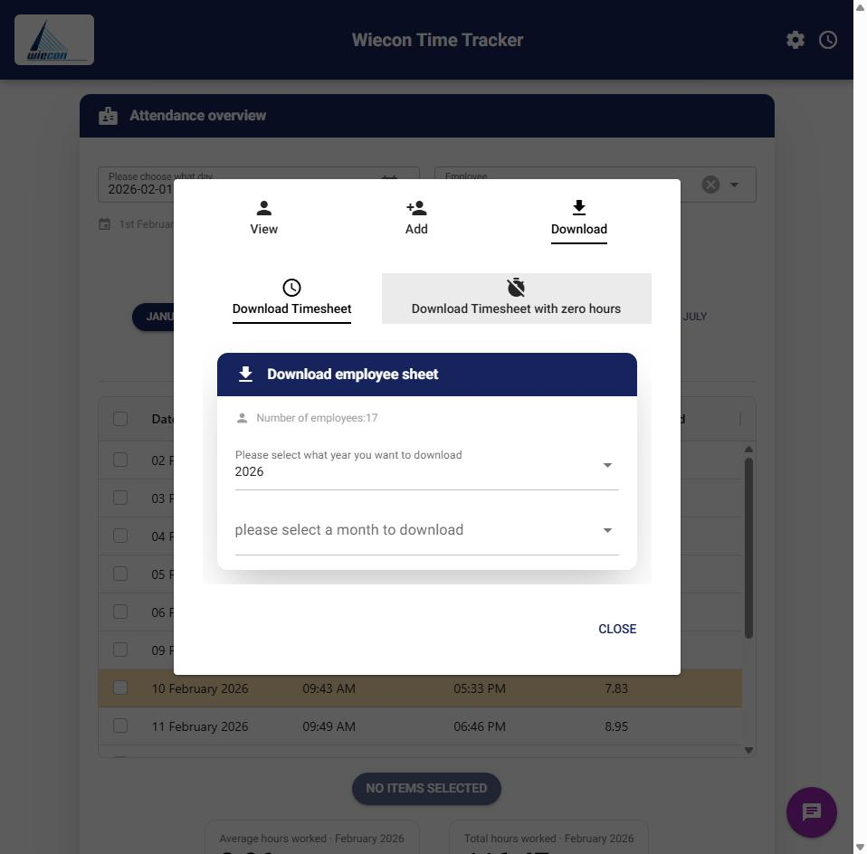

Each page repeats the table above for one person and closes with their average and total:

**Attendance Report - 王雅婷 Alice Bennett**

| Date | Start Time | End Time | Hours Worked |
| :--- | :---: | :---: | ---: |
| 05 January 2026 | 08:57 AM | 05:32 PM | 8.58 |
| 06 January 2026 | 08:59 AM | 05:28 PM | 8.48 |
| **Average Hours Worked** | | | **8.53 h** |
| **Total Hours Worked** | | | **17.06 h** |

The real file: **[attendance-report-alice-bennett.pdf](docs/samples/attendance-report-alice-bennett.pdf)** — produced by the run above, not transcribed.

> [!TIP]
> That total is the figure the firm files.

---

## 07. Scope and known issues

### What it doesn't do

| Not included | Status                                                                                                                             |
| --- |------------------------------------------------------------------------------------------------------------------------------------|
| Payroll calculation | Out of scope                                                                                                                       |
| Leave and vacation tracking | Out of scope                                                                                                                       |
| Editing records after import | Out of scope                                                                                                                       |
| Any form of login | Not implemented — anyone who opens the app sees every employee's records under  the idea that only one person is using the software |

### Known issues

**Employees must exist before their punches will import.** A punch whose badge number has no matching employee violates a foreign key and is dropped. The upload notification lists the skipped IDs, which is easy to miss on a large file.

**There is no bulk employee import in the UI.** A function that reads an employee CSV exists in the database layer, but nothing calls it. Employees are added one at a time through the Add tab, so a fresh database means entering everyone by hand before the first import will do anything.

**Re-uploading the same file duplicates rows.** There is no unique constraint on a punch, and nothing checks whether one is already stored. Importing the same file twice was measured to take the table from 6 rows to 12. Derived hours are unaffected, since a day is reduced to its first and last punch, but the table grows on every re-import.

---

## 08. Milestones

How the program has grown, in what it can do.

| Milestone | What it brought |
| :--- | :--- |
| **Monthly hours from the punch files** | Upload the attendance CSV and get every employee's hours for the month (August 2026) |
| **AI assistant** | Ask it how many hours someone worked on a day or in a month, and it answers from the real attendance data |
| **Employees managed in the app** | Add and remove employees without an external database tool, with a confirmation before anything is deleted |
| **More reports** | A zero-hours sheet for missed punch-outs, and one employee across any months in a single PDF |
| **Latest** | 0.9.0, October 2026 |

 

## 09. Copyright and license

Copyright © 2026 Immanuel Wiessler and Wiecon Consultants Taiwan. All rights reserved.

This is proprietary software, not open source. It is shared here so that it can be read and reviewed; it may not be copied, modified, distributed or used elsewhere without written permission. The full terms are in the [LICENSE](LICENSE) file.

For permission or questions: [im.wiessler@gmail.com](mailto:im.wiessler@gmail.com) · GitHub [@ThunderIW](https://github.com/ThunderIW)
